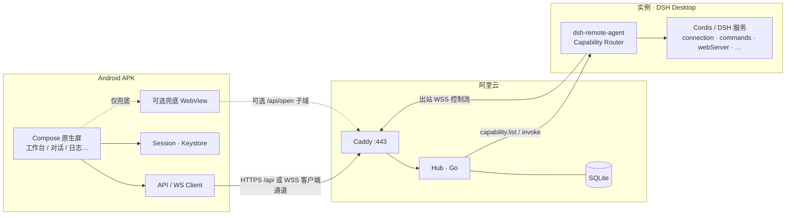

> **已被 v2 取代**：请阅读 `/workspace/remote-mgmt/docs/android-client-design-v2.md`（及 `/workspace/android-client-design-v2.md`）。本文仅作历史参考。

# DSH Remote · Android 客户端设计 v1.1（能力桥）

> 状态：设计稿，未改动任何代码或环境  
> 日期：2026-10-24（Asia/Shanghai）  
> 相对 **v1**：纠偏产品主路径——APK 是**原生遥控器 / 能力客户端**，经 Hub → `dsh-remote-agent` **Capability Bridge** 调用桌面 DSH 能力；**不再**以 WebView 打开 `*.d.` 子域网页为主路径。  
> 相对 **v3.1**：Hub + 插件骨架仍在；插件新增能力桥；手机端从「打开网页」改为「原生 Compose 屏 + 结构化 RPC」。

**权威 Hub 设计**：`/workspace/remote-mgmt/docs/remote-mgmt-design-v3.1.md`（及仓库根同名副本）。本文件只扩展「安卓客户端 + 能力桥」。

---

## 0. 需求（已纠偏）

用户明确否定 v1 的「安卓内嵌 WebView / Custom Tabs 打开 DSH 网页」方案，认为「和打开网页没区别」。

**要的是**：Android APK **原生界面**直接调用桌面端 DSH 的功能（经 Hub → `dsh-remote-agent` RPC），在手机上用 Compose 渲染结果——对话、模型、状态、日志、重启等，而不是远程浏览 dsh web。

**不是**：把 DSH 或 Agent 搬到安卓；不是完整复刻 DSH 全部 UI；不是远程桌面 / 任意 shell。

术语对齐 v3.1：

| 术语 | 含义 |
|---|---|
| **实例**（Instance） | 一台装了 `dsh-remote-agent` 的 DSH Desktop |
| **Hub** | Go 单二进制 + SQLite，`remote.zhuhedong.cn` |
| **客户端**（Client） | 本设计中的 Android APK（及桌面 Web 管理台） |
| **能力桥**（Capability Bridge） | 插件新增：把桌面 DSH / Cordis 服务封装为可列举、可调用的能力，经控制流 RPC 回传结构化 JSON |
| **能力**（Capability） | 一条带 `id`、参数 schema、可选流式的远程可调用操作 |

---

## 1. 定位纠偏 / 非目标

**定位（v1.1）**

- APK = **原生遥控器 / 能力客户端**，不是迷你浏览器。
- 默认路径：**Phone Compose → Hub API/WS → Agent capability router → 本机 DSH 服务** → 结构化 JSON → Compose 渲染。
- **WebView 打开 DSH 网页降为可选兜底**（未映射能力、调试、或用户主动点「在网页中打开」）；默认路径**不再**是 `/api/open` + 子域网页。
- Hub 与 `dsh-remote-agent` 仍在；插件在既有管理 RPC 之上新增 **Capability Bridge**。
- 侧载分发、密码+强制 TOTP、证书锁定、敏感操作重验证：沿用 v1 / v3.1 安全基线。

**非目标**

- L2：完整复刻 DSH 全部 UI、远程桌面、任意 shell、通用文件管理。
- 不把 Agent 移植到安卓；不在安卓上跑 DSH。
- MVP 不上架 Play；不做完整 Passkey（留接入点）。
- 不做多 Hub / 企业 MDM（开放问题可后续）。

**与 v1 的关系**

| v1 | v1.1 |
|---|---|
| 主路径：`/api/open` → WebView SSO → 浏览 dsh web | 主路径：`capabilities` + `invoke` → 原生屏 |
| 插件零改动 | 插件新增能力桥（控制流 RPC） |
| 「打开 DSH」= 打开网页 | 「使用实例」= 进入原生工作台；网页仅兜底 |

---

## 2. 默认决策（可改）

| # | 决策 | 默认 | 可改方向 |
|---|---|---|---|
| D1 | 产品定位 | APK = **原生能力客户端**（遥控器）；桌面仍可用 Hub Web **管理台** | 仅管理壳 / 仅网页 |
| D2 | 技术栈 | Kotlin + Jetpack Compose + Material 3；minSdk 28；OkHttp + Retrofit（或 Ktor）；可选 OkHttp WebSocket 客户端通道；EncryptedSharedPreferences + Keystore | Flutter / RN（不推荐） |
| D3 | 使用桌面功能 | **能力桥默认**；WebView / Custom Tabs **仅兜底**（未覆盖能力或调试） | 强制仅能力桥、去掉兜底 |
| D4 | 认证 | 用户名 + 密码 + **强制 TOTP**；生物识别只解锁本地会话 | 远期 Passkey |
| D5 | 推送 | MVP：轮询或 Hub 事件；FCM 接入点留给 Hub 0.2+ | 一开始就接 FCM |
| D6 | 分发 | 首期侧载：`/dl/android/` + 版本检查 | 上架 Play |
| D7 | 安全 | Pinning；禁明文；敏感能力重新验证；脱敏；能力调用审计 | pinning 例外 |
| D8 | 与 PWA / Web | 桌面 Web 控制台保留（管理向）；手机主端 = Android 能力客户端；PWA 可选 | 并行完整 PWA |
| D9 | 能力版本 | App 与 agent 能力集取**交集**；UI 只显示双方都支持的 | 强制最低 agent 版本 |
| D10 | L1 对话等 | 先真机探针确认 DSH 内部接口，再包一层；**不假装已有公开 API** | 仅做 L0 管理能力 |

---

## 3. 架构



**默认数据路径（能力桥）**

1. App 登录 Hub，拉实例列表（既有 `/api/instances`）。
2. 进入某实例工作台 → `GET /api/instances/:id/capabilities`（或控制流等价）→ 渲染能力卡片。
3. 用户点某能力 → `POST /api/instances/:id/invoke`（或 WSS `capability.invoke`）→ Hub 鉴权 + ACL → 控制流下发到插件。
4. 插件 Capability Router 调本机 Cordis/DSH 服务 → 结构化 JSON（或流式 chunk）回传 → App Compose 渲染。

**不再默认**：Phone → 子域 `dsh--*.d.` → 整页 dsh web。

不变的部分（对齐 v3.1）：

- Hub 用户/会话/ACL、实例登记、出站 WSS + yamux、插件侧栏登记、签名升级、日志脱敏。
- 子域代理 + `/api/open` SSO **保留**，供桌面 Web 管理台与 App **兜底**使用。

变的部分：

- 插件：新增能力目录与 `capability.*` RPC。
- Hub：转发/鉴权能力调用；可选客户端 WSS 通道做流式。
- App：原生工作台；WebView 模块降级为 fallback。

---

## 4. 能力目录（分档）

### 4.1 L0 — 已对齐 v3.1 §8，马上可做

这些能力插件侧大多已有或易包一层，**不依赖**未公开的 DSH 业务 API：

| 能力 id（建议） | 说明 | 权限 | 流式 |
|---|---|---|---|
| `instance.status` | 在线、版本（DSH/插件/OS/Node） | open | 否 |
| `instance.metrics` | CPU / 内存 / 负载 / 磁盘 / RSS / 事件循环延迟 | open | 否 |
| `instance.logs.tail` | 脱敏日志尾（环形缓冲 / 白名单文件） | manage | 可选 |
| `dsh.restart` | 重启 DSH | restart | 否 |
| `plugin.reload` | 重载本插件（若 Cordis 支持） | restart | 否 |
| `plugin.update` | 升级插件（走 §9） | update | 否 |
| `services.health` | 白名单服务健康 | open | 否 |
| `instance.enrollment` | 登记/吊销状态摘要 | open / manage | 否 |

App 对应原生屏：实例工作台概览、指标卡、日志尾、操作区（带重验证）。

### 4.2 L1 — 需插件包一层 DSH 内部接口（待探针）

**写成「待探针确认的目标能力」**，不要假装已有公开 API。实现前必须在真机 DSH Desktop 上做**只读探测**（读源码 / 运行时 inject 的服务 / `connection.rpc` / 侧栏已有调用），确认稳定入口后再封装。

| 目标能力 id | 期望体验 | 探针关注点 |
|---|---|---|
| `chat.sessions.list` | 会话/对话列表 | 是否有稳定会话存储服务、ID 形态、权限边界 |
| `chat.message.send` | 发送消息 + **流式回复** | 事件名、chunk 格式、取消/超时 |
| `models.list` / `models.set` | 模型列表与切换 | 配置落盘位置、是否需重启、与「Our Free Model」等插件关系 |
| `workspace.summary` | 当前工作区摘要 | 工作区根路径、是否敏感路径需脱敏 |

探针失败则 L1 不做进里程碑 A1，App 仅保留 L0 + 兜底 WebView。

### 4.3 L2 — 明确不做

- 完整复刻 DSH 全部 UI / 插件市场整页。
- 远程桌面、任意 shell、任意文件读写、通用 TCP。
- 把手机变成第二台 DSH。

---

## 5. 协议草图（Capability Bridge）

### 5.1 Hub HTTP（建议）

| 方法 | 路径 | 说明 |
|---|---|---|
| GET | `/api/instances/:id/capabilities` | 返回该实例当前能力目录（已与 agent 协商后的交集视图，或原样 + App 本地再交） |
| POST | `/api/instances/:id/invoke` | body：`{ id, params, requestId }`；同步结果或返回 `accepted` 后走事件/WS |
| GET/WS | `/api/me/events` 或实例级 WSS | 推送 `capability.chunk` / `capability.done` / 实例状态 |

（名称可在实现时与 OpenAPI 对齐；语义固定。）

### 5.2 控制流 RPC（Hub ↔ Agent）

```text
capability.list
  → { capabilities: [{
        id: string,
        title: string,
        description?: string,
        params: JSON Schema | 简化 schema,
        stream?: boolean,
        minAgentVersion?: string,
        permission: "open"|"manage"|"restart"|"update",
        sensitive?: boolean
      }] }

capability.invoke { id, params, requestId }
  → result { requestId, ok: true, data }
  | error  { requestId, ok: false, code, message }

# 流式（stream:true）
event capability.chunk { requestId, seq, data }
event capability.done  { requestId, ok, data? | error? }
event capability.cancel { requestId }   # 客户端取消
```

### 5.3 权限与敏感

- 沿用实例 ACL：`(user, instance, service|*, {open, manage, restart, update})`；每条能力声明所需 permission。
- `sensitive: true`（重启、升级、吊销、将来可能的破坏性 L1）→ 与 v3.1 一致：**10 分钟内重新验证**。
- 审计：每次 invoke 记用户、实例、capability id、requestId、结果码（参数脱敏）。

### 5.4 版本协商

1. Agent 在 `welcome` 或 `capability.list` 中带 `agentCapVersion` + 能力列表。
2. App 内置 `appCapVersion` + 已知能力 id 集合。
3. **UI 只展示交集**；未知能力不渲染（可进「高级 / 原始 JSON」调试区，默认折叠）。
4. 若关键 L0 缺失 → 工作台提示「请升级插件」并给出 Hub 升级入口。

### 5.5 与既有管理 RPC 的关系

- v3.1 已有状态/指标/日志/重启等控制消息可 **直接映射为 L0 能力**（一层薄 facade），避免两套语义。
- 子域 HTTP 代理与 SSO **保留**，不删除；仅不再作为手机主路径。

---

## 6. 安卓信息架构（原生屏）

```text
登录（密码 + TOTP）
  └─ 实例列表（在线 / 指标摘要 / 管理入口）
        └─ 实例工作台（能力卡片网格）
              ├─ 原生 · 状态与指标（L0）
              ├─ 原生 · 日志尾（L0）
              ├─ 原生 · 操作：重启 / 升级（L0，重验证）
              ├─ 原生 · 对话（L1，探针成功后）
              ├─ 原生 · 模型（L1）
              └─ 兜底 ·「在网页中打开 DSH」（可选，WebView）
  └─ 设置（会话、生物识别、pinning 状态、检查更新、关于）
```

- **不是**默认进 WebView。
- 工作台根据 `capability.list` ∩ App 支持集动态显示卡片；无能力则空状态 + 升级提示。

建议模块目录（相对 v1 调整）：

```
dsh-remote-android/
├─ app/src/main/java/.../remote/
│  ├─ ui/          # login, instances, workbench, chat, logs, settings
│  ├─ data/api/    # auth, instances, capabilities, invoke
│  ├─ data/ws/     # 可选客户端通道 / chunk
│  ├─ domain/      # Login, ListCaps, Invoke, StreamChat…
│  ├─ fallback/    # 可选 WebView（降级）
│  ├─ update/
│  └─ security/
```

---

## 7. 与 Hub / 插件增量清单

| 层 | 增量 | 优先级 |
|---|---|---|
| Hub | `GET …/capabilities`、`POST …/invoke`；鉴权/ACL/审计；流式事件通道 | A0 |
| Hub | `/dl/android/latest.json`（沿用 v1） | A0 |
| Agent | Capability Router + L0 facade（映射既有管理 RPC） | A0 |
| Agent | L1 适配器（仅探针确认后的接口） | A1 |
| App | 登录、列表、工作台、L0 原生屏、版本交集 | A0 |
| App | L1 对话流式 Compose UI | A1（探针成功） |
| App | 兜底 WebView | A2 |

插件与 Agent **不再零改动**（相对 v1 声明）；yamux / 登记 / SSO 本机逻辑仍沿用 v3.1。

---

## 8. 安全（威胁增量）

对齐 v3.1 §12，并相对 v1 调整：

| 威胁 | 对策 |
|---|---|
| 伪冒 Hub / MITM | HTTPS + 公钥 pinning（主域；兜底 WebView 仍钉 `*.d.`） |
| 能力越权 | Hub 侧按 ACL 过滤；插件再校验 permission；敏感能力重验证 |
| 把手机当任意 RCE | **不提供**任意 shell；能力白名单；参数 schema 校验 |
| 会话窃取 | Keystore；远程踢出；锁屏生物识别 |
| 流式内容泄露 | 日志脱敏；chunk 不写 logcat；截屏策略可按屏配置 |
| 恶意更新 | APK sha256；插件升级仍走发布公钥验签 |
| 探针阶段误调写接口 | L1 探针**只读**；封装前代码评审 |

---

## 9. 里程碑

| 阶段 | 内容 | 状态 |
|---|---|---|
| **A0** | 能力桥协议（list/invoke/chunk）+ Hub 转发 + Agent L0 facade + App 登录/列表/**L0 原生工作台** | 未完成 |
| **A1** | 真机 L1 只读探针；若成功：原生对话流式 + 模型/工作区摘要 | 未完成（依赖探针） |
| **A2** | 兜底 WebView **仅**未覆盖能力 / 调试；设置页开关 | 未完成 |
| Hub 0.1 并行 | 登录 TOTP、登记、WSS、既有管理 RPC（能力桥可叠在其上） | 按 v3.1 |
| 1.0 | 安全复查、文档、稳定能力集冻结 | 未完成 |

依赖：A0 可与 Hub/插件 MVP 并行设计；联调需实例在线 + 控制流可用。A1 **不得**在探针完成前写死「已支持对话」。

---

## 10. 开放问题（需用户拍板）

1. **最想先在手机上原生用的桌面功能 Top3？**（对话？切模型？看日志？重启？指标？）→ 决定 A0/A1 排序。
2. 兜底 WebView：默认隐藏，还是工作台保留入口？
3. 流式通道：优先 HTTP 长轮询 / SSE，还是客户端 WSS？
4. 包名与显示名：`cn.zhuhedong.remote`？「DSH 远程」？
5. 是否上架 Play / 国内商店，还是长期 Hub 侧载？
6. 推送：MVP 可否无推送？
7. 生物识别默认开还是关？
8. 最低 API 28 是否覆盖你的手机？
9. L1 探针窗口：你方便提供一台已装 DSH Desktop 的机器做只读探测的时间？
10. 能力命名空间：`chat.*` / `instance.*` 是否接受，还是要跟现有控制消息名完全一致？

---

## 11. 对 v1 / v3.1 的影响

**相对 v1（本文取代其主路径）**

- D1/D3 改写：能力桥默认；WebView 兜底。
- 删除「插件零改动」；改为「插件 + 能力桥」。
- 信息架构以工作台能力卡片为中心，而非「打开 DSH」按钮为主 CTA。

**相对 v3.1（建议后续补丁，先不直接改 v3.1 正文除非确认）**

1. 客户端节点：手机主端 = Android 能力客户端；「打开 DSH」保留为管理/兜底。
2. §8 管理功能表可映射为 L0 能力目录。
3. §5 控制流增加 `capability.*`。
4. §13 Hub API 增加 capabilities / invoke。
5. 威胁模型：能力白名单防 RCE 语义。

**明确不改**：登记码语义、出站 WSS、yamux、发布验签、本机 `authenticatedUrl` SSO（仍供网页路径使用）。

---

## 12. 测试计划（增量）

- 协议：list 交集、未知能力忽略、敏感 invoke 无重验证应 401/403。
- L0：离线实例、重启确认、日志脱敏、升级验签失败回滚提示。
- L1（若启用）：流式乱序/取消、长回复内存、模型切换后列表一致性。
- 兜底：关闭能力桥时 WebView 仍可用（回归）；默认路径自动化测试**不得**依赖 WebView。
- 安全：pin 失败、Intent 无票据、备份无会话。

---

## 13. 下一步（设计通过后）

1. 你拍板开放问题 **#1（Top3）** 以及兜底/流式通道偏好。  
2. 冻结 `capability.list` / `invoke` schema（可先 JSON Schema 草案）。  
3. Agent 实现 L0 facade + Hub 转发；App 空工程打通登录 → 工作台 → 一条 L0 invoke。  
4. 另开「L1 探针」任务：只读探测真机 DSH，输出可否做对话/模型的结论后再开 A1。
