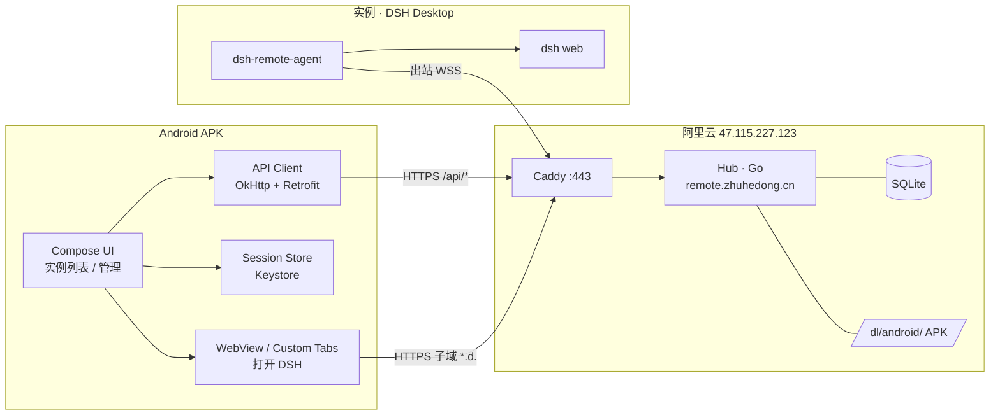
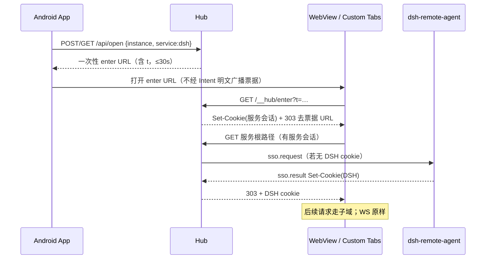

> **已被 v2 取代**：请阅读 `/workspace/remote-mgmt/docs/android-client-design-v2.md`（及 `/workspace/android-client-design-v2.md`）。本文仅作历史参考。

# DSH Remote · Android 客户端设计 v1

> **已被 v1.1 取代**：主路径改为「原生能力桥」，WebView 打开 DSH 网页不再是默认。见 [android-client-design-v1.1.md](./android-client-design-v1.1.md)。


> 状态：设计稿，未改动任何代码或环境  
> 日期：2026-10-24（Asia/Shanghai）  
> 相对 v3.1 的变化：把**手机使用端**从「手机优先 PWA / 浏览器」升级为**原生安卓 APK**；Hub（Go）与设备端插件 `dsh-remote-agent` **不变**。原里程碑「0.4.0 PWA」改为「Android 客户端 MVP」，PWA 降为可选。

---

## 0. 需求（已确认）

用户要把已有的 DSH 远程管理平台（Hub：`remote.zhuhedong.cn`）在手机上的**使用端**做成原生安卓 APK：登录 Hub、看实例、打开 DSH（免二次登录）、做管理操作。  
**不是**把设备 Agent 换成安卓；DSH Desktop 仍跑在 Mac/PC 上，插件仍是 TypeScript。

权威架构见 `/workspace/remote-mgmt-design-v3.1.md`。本文件只扩展「客户端」一层。

术语对齐 v3.1：

| 术语 | 含义 |
|---|---|
| **实例**（Instance） | 一台装了 `dsh-remote-agent` 的 DSH Desktop |
| **Hub** | Go 单二进制 + SQLite，`remote.zhuhedong.cn` |
| **客户端**（Client） | 本设计中的 Android APK（及仍保留的桌面 Web 控制台） |
| **服务会话** | 打开某实例某服务时 Hub 在 `*.d.remote.zhuhedong.cn` 上设的 cookie |

---

## 1. 定位 / 非目标

**目标**

- Android 原生 App = **Hub 控制台** + **内嵌打开 DSH**（WebView / Custom Tabs），替代手机上的 PWA。
- 桌面继续用内嵌于 Hub 的 Web 控制台；两端共用同一套 `/api/*`。
- 打开 DSH 的 SSO 流程与 v3.1 §6 完全一致：`/api/open` → 子域 `/__hub/enter?t=` → Set-Cookie → 打开服务；插件本机 `authenticatedUrl` 不变。
- 侧载分发：Hub `/dl/android/` 提供签名 APK + 版本检查；不上架 Play（开放问题）。
- 安全默认：TLS、证书公钥锁定、EncryptedSharedPreferences / Keystore、敏感操作重新验证、脱敏日志、票据不进 Intent/日志。

**非目标**

- 不把 `dsh-remote-agent` 移植到安卓；不在安卓上跑 DSH。
- 不做远程桌面、任意 TCP、VPN、文件传输（与 v3.1 远期一致）。
- MVP 不上架 Google Play；不做完整 Passkey（留 Credential Manager 接入点）。
- 不做多 Hub 切换、企业 MDM 强制策略（开放问题可后续加）。

---

## 2. 默认决策（可改）

| # | 决策 | 默认 | 可改方向 |
|---|---|---|---|
| D1 | 产品定位 | 原生 APK = Hub 控制台 + 打开 DSH；桌面仍用 Web | 仅壳浏览器 / 仅 Custom Tabs |
| D2 | 技术栈 | Kotlin + Jetpack Compose + Material 3；minSdk 28；最新稳定 targetSdk；OkHttp + Retrofit（或 Ktor Client）；EncryptedSharedPreferences + Android Keystore；CameraX 扫码；Credential Manager 远期 Passkey | Flutter / RN（不推荐，与 Hub 安全模型更难对齐） |
| D3 | 打开 DSH | 优先 Custom Tabs；不行则 App 内 WebView（完整 CookieJar、第三方 cookie、WebSocket、与 Hub 子域同进程注入服务会话 cookie） | 始终系统浏览器（体验差、cookie 难控） |
| D4 | 认证 | 用户名 + 密码 + **强制 TOTP**（系统 Authenticator 或应用内 6 位）；会话刷新 / 踢出；生物识别只解锁本地已存会话（不上云） | 远期 Passkey |
| D5 | 推送 | MVP：轮询或复用 Hub 已有事件通道；设计 FCM 接入点留给 Hub 0.2+ | 一开始就接 FCM |
| D6 | 分发 | 首期侧载：`/dl/android/` 签名包 + 应用内版本检查 | 上架 Play / 应用商店 |
| D7 | 安全 | Pinning（`remote.zhuhedong.cn` 与 `*.d.`）；禁止明文；敏感操作重新验证；脱敏；票据不进 Intent/日志 | pinning 例外列表 |
| D8 | 与 PWA | Web 控制台保留；里程碑 0.4.0 改为 Android MVP；PWA 可选 | 并行维护完整 PWA |

---

## 3. 架构



不变的部分（对齐 v3.1）：

- Hub API、子域路由、一次性票据、插件本机 SSO、yamux 复用连接。
- 请求路径仍是：客户端 → Caddy → Hub → 实例复用流 → 插件 → 本机 dsh web。

变的部分：

- 手机上的「客户端」从浏览器/PWA 换成 APK。
- APK 负责：登录与会话、实例列表与管理操作、调用 `/api/open`、在 WebView/Custom Tabs 里完成 enter 与后续浏览、侧载升级检查。

---

## 4. 与 Hub API 对齐（v3.1 §13）

App 只消费已有（或里程碑中规划的）HTTP API，**不**直连实例、不发明私有协议。

| 能力 | 端点（既有） | App 行为 |
|---|---|---|
| 登录 / TOTP | `/api/auth/*` | 登录页；失败限速提示 |
| 当前用户 | `/api/me`（若已有）或 auth 返回体 | 顶栏身份 |
| 会话 | `/api/me/sessions` | 会话列表、踢出本机以外会话 |
| 实例列表 / 详情 | `/api/instances[/:id]` | 首页卡片、详情 Tab |
| 服务 | `…/services` | 「打开 DSH / Grafana…」 |
| 打开服务 | `/api/open` | 拿一次性 URL / 票据，交给 WebView 或 Custom Tabs |
| 指标 / 日志 | `…/metrics`、`…/logs` | 图表与只读日志 |
| 操作 | `…/actions/{restart-dsh,reload-plugin,update}` | 需近期重新验证 |
| 登记码 | `/api/enroll-codes` | 生成码 + 二维码展示；CameraX 扫码仅用于**读出登记码展示给本机用户**（登记仍在 DSH 侧栏完成） |
| 审计 / 用户 / ACL | `/api/audit`、`/api/users`、`/api/acl` | owner/admin 可见 |
| 通知设置 | `/api/notify` | 0.2+ |
| 下载 | `/dl/*`、`/dl/android/` | APK 与版本清单 |
| 子域进入 | `https://<svc>--<inst>.d…/__hub/enter?t=` | WebView 内跟随 303，收 cookie |

Hub 侧为 Android 需**增量**（尽量薄）：

1. `/dl/android/latest.json`：`versionCode`、`versionName`、`apkUrl`、`sha256`、`minSdk`、发布说明。
2. （可选，Hub 0.2+）设备推送 token 登记：`POST /api/me/devices`（FCM），离线/异常登录走推送。
3. User-Agent / 客户端类型写入会话表，便于「踢出会话」页区分 Android。

插件与 Agent 协议：**零改动**。

---

## 5. 认证与会话

### 5.1 登录流（MVP）

1. 输入用户名、密码 → `POST /api/auth/login`（名称以 Hub 实现为准）。
2. 若要求 TOTP → 输入 6 位（可深链到系统 Authenticator；MVP 不做自动填充）。
3. 成功后拿到会话凭证（cookie 或 bearer，**以 Hub Web 控制台既有方案为准**；App 用同一套，便于 CSRF/会话模型一致）。
4. 凭证写入 `EncryptedSharedPreferences`；密钥由 Android Keystore 保护。
5. 可选：开启生物识别后，冷启动只做本地解锁，**不**把生物特征或 PIN 同步到 Hub。

### 5.2 会话生命周期

- 与 v3.1 §7 一致：空闲 7 天、最长 30 天；可踢单会话或全部。
- App 检测 401 → 清本地会话 → 登录页。
- 敏感操作（吊销实例、改权限、远程重启、升级、改密码）前要求 **10 分钟内重新验证**（密码或 TOTP，跟 Hub）。

### 5.3 远期 Passkey

- 使用 Credential Manager API；Hub 已规划 Passkey（v3.1 0.4.0）。
- Android 客户端在 Hub Passkey 落地后跟进，不阻塞 MVP。

---

## 6. 打开 DSH（WebView / SSO）

对齐 v3.1 §6.2–§6.3，客户端侧步骤：



### 6.1 Custom Tabs vs WebView

| 方式 | 优点 | 缺点 | 选用 |
|---|---|---|---|
| Custom Tabs | 系统浏览器内核、密码管理器友好 | cookie 与 App 隔离，子域服务会话难与「返回 App」联动 | **优先尝试**；若无法可靠完成 enter→cookie→返回，则降级 |
| App 内 WebView | 可控 CookieJar、可注入、可拦截、可与 Compose 导航叠层 | 实现成本高；需处理第三方 cookie、WS、文件选择、下载 | **MVP 主路径后备 / 默认可靠路径** |

**默认（可改）**：实现完整 WebView 路径作为可靠默认；若实测 Custom Tabs 能稳定完成 SSO 且用户体验更好，再把 Custom Tabs 设为偏好。

### 6.2 WebView 硬性要求

- 与 Hub API 共用或可同步的 CookieJar（至少覆盖 `remote.zhuhedong.cn` 与 `*.d.remote.zhuhedong.cn`）。
- 允许第三方 cookie **仅限** `*.d.remote.zhuhedong.cn` 相关（能收窄则收窄）。
- 支持 WebSocket（DSH `/api`）。
- `Referrer-Policy` / 不把 `t=` 写进系统日志；崩溃上报前脱敏。
- 证书：对 Hub 与子域做 **公钥 pinning**（备份 pin）；pin 失败则拒绝加载并提示更新 App。
- 不在 `Intent` extras、通知、日志、截屏文件名中携带票据。

### 6.3 返回与多实例

- WebView 全屏打开 DSH；系统返回键先 WebView 历史，再回实例详情。
- 多实例：每个服务子域独立 cookie；切换实例不复用错误 cookie。

---

## 7. 功能清单（App）

| 功能 | MVP | 后续 |
|---|---|---|
| 登录 + TOTP | ✓ | Passkey |
| 生物识别解锁本地会话 | ✓（可选） | — |
| 实例列表（在线/离线/指标摘要） | ✓ | 推送刷新 |
| 打开 DSH / 白名单服务 | ✓ | — |
| 实例详情：概览 / 服务 / 操作 / 日志 | ✓（日志只读） | 图表细化 |
| 会话管理（查看 / 踢出） | ✓ | — |
| 生成登记码 + 展示二维码 | ✓ | CameraX 扫码辅助录入 |
| 远程重启 / 升级插件 | ✓（权限 + 重新验证） | — |
| 用户 / ACL / 审计 | owner/admin | — |
| 应用内检查更新 APK | ✓ | 增量 / 签名校验 UI |
| 离线 / 异常登录通知 | 轮询或 Hub 事件 | FCM |
| 深色模式 / 动态取色 | Material 3 跟随系统 | — |

登记流程提醒：扫码/展示码是为了把码送到 **DSH 侧栏**；安卓 App **不能**代替插件完成 `POST /agent/enroll`（那是设备身份）。

---

## 8. 模块与建议目录结构

```
dsh-remote-android/
├─ app/
│  ├─ src/main/
│  │  ├─ java/.../remote/
│  │  │  ├─ RemoteApp.kt
│  │  │  ├─ ui/                 # Compose：login, home, instance, settings, web
│  │  │  ├─ data/
│  │  │  │  ├─ api/             # Retrofit 接口，对齐 /api/*
│  │  │  │  ├─ session/         # EncryptedSharedPreferences + CookieJar
│  │  │  │  └─ repo/
│  │  │  ├─ domain/             # 用例：Login, OpenService, KickSession…
│  │  │  ├─ web/                # WebViewClient、SSO、Pinning WebView
│  │  │  ├─ push/               # 预留 FCM
│  │  │  ├─ update/             # /dl/android/latest.json
│  │  │  └─ security/           # pinning、redact、biometric
│  │  └─ res/
│  └─ build.gradle.kts
├─ gradle/
└─ README.md
```

包名建议（可改）：`cn.zhuhedong.remote` 或 `cn.zhuhedong.dsh.remote`。  
签名：单独上传密钥；与 Hub 发布密钥、插件发布密钥分离。

---

## 9. 安全

对齐并扩展 v3.1 §12：

| 威胁 | App 对策 |
|---|---|
| 伪冒 Hub / MITM | HTTPS only；证书公钥 pinning（主域 + 子域）；备份 pin |
| 会话窃取 | HttpOnly cookie 或等价；Keystore；锁屏后生物识别；远程踢出 |
| 票据泄露 | 内存持有；WebView 直接加载；禁止 log / Intent / 剪贴板；30s 一次性仍由 Hub 保证 |
| 截屏泄露 TOTP/密码 | 登录与 TOTP 页 `FLAG_SECURE`（可关，默认开） |
| 备份泄露 | `allowBackup=false` 或排除会话文件 |
| 日志泄露 | 与 Hub 同一套脱敏规则（token、cookie、`t=`、JWT） |
| 恶意更新 | `latest.json` + APK sha256；系统包管理验签；可选同签名升级 |
| WebView 漏洞 | 禁 `file://` 随意访问；JS 桥最小化；只打开 Hub 允许的 host |

---

## 10. 分发与升级

1. CI（或本机）打 release APK（或 AAB，侧载用 APK），计算 sha256。
2. 上传到 Hub：`/dl/android/dsh-remote-<version>.apk` + `latest.json`。
3. App 启动或设置页检查：`versionCode` 更大则提示下载；下载后校验 sha256，再调系统安装器（需用户授权「未知来源」）。
4. 不做静默安装。

Play 上架：见开放问题；若上架，侧载通道可保留给内部包。

---

## 11. 里程碑（相对 v3.1 §17 的调整）

| 版本 | 内容 | 状态 |
|---|---|---|
| **Hub/插件 0.1.0 MVP** | 仍按 v3.1：登录+TOTP、登记、WSS、子域、票据、最小 Web 控制台、插件 SSO | 未完成 |
| **Android 0.1.0 MVP**（原「0.4.0 PWA」中的手机客户端职责前移） | 登录+TOTP、实例列表、打开 DSH（WebView SSO）、会话踢出、侧载更新检查；对齐 Hub 0.1 API | 未完成 |
| **Android 0.2.0** | 指标图、日志、登记码 UI、生物识别解锁、通知（轮询/SSE） | 未完成 |
| **Hub 0.2.0+** | 离线通知；可选 FCM device token API | 未完成 |
| **Android 0.3.0** | 多用户 ACL UI、重新验证、重启/升级操作、审计 | 未完成 |
| **Android 0.4.0** | Passkey（Credential Manager）、FCM、打磨 WebView / Custom Tabs | 未完成 |
| **PWA** | 降为可选；桌面 Web 控制台始终保留 | 未完成 |
| **1.0.0** | 安全复查、文档、稳定版（含 Android） | 未完成 |

依赖：Android MVP 可与 Hub 0.1 并行设计；联调需 Hub 0.1 的 `/api/auth`、`/api/instances`、`/api/open`、子域 enter 可用。

---

## 12. 开放问题（需用户拍板）

1. **包名与应用显示名**：`cn.zhuhedong.remote`？显示名「DSH 远程」还是「Remote Hub」？
2. **打开 DSH 默认路径**：强制 WebView，还是「尽量 Custom Tabs」？
3. **是否上架 Google Play**（以及国内应用商店）？还是长期仅 Hub 侧载？
4. **推送**：MVP 是否接受无推送（打开 App 才看状态），还是希望尽早 FCM（需 Google 服务 / 国内替代如厂商推送）？
5. **生物识别**：默认引导开启，还是默认关？
6. **登记扫码**：App 是否需要 CameraX 扫 Hub 登记二维码（只展示码），还是仅在 Hub Web / 桌面生成、在 DSH 侧栏粘贴即可？
7. **多账号**：同一 App 是否支持切换多个 Hub 用户？还是单用户足够？
8. **最低系统**：API 28（Android 9）是否覆盖你的手机？是否要升到 API 29/31？
9. **与现有 Web 控制台 UI**：Android 是否视觉对齐 Preact 控制台，还是 Material 3 独立视觉？
10. **Hub 增量优先级**：`/dl/android/latest.json` 与会话 UA 字段是否同意进 0.1？FCM 是否明确放到 0.2+？

---

## 13. 对 v3.1 的影响（建议补丁说明）

写入 v3.1 时建议改这些表述（本 v1 先独立成文，不直接改 v3.1 正文，除非你确认）：

1. §0 / §2 / §14：「手机 PWA」→「Android 原生客户端（主）+ 可选 PWA；桌面浏览器控制台保留」。
2. §17 里程碑：`0.4.0` 中「PWA」改为「Android 客户端 MVP」；PWA 挪到可选或 0.5+。
3. §13 Hub 接口列表追加：`/dl/android/*`、（0.2+）`/api/me/devices`。
4. §12 威胁模型追加一行：移动客户端失窃 → 远程踢会话 + 生物识别锁 + 服务端会话过期。
5. 架构图 Clients 节点：`手机 PWA` → `Android APK` + `电脑浏览器`。

**明确不改**：插件目录、yamux、SSO 本机 `authenticatedUrl`、子域模型、登记码语义、Go Hub 选型。

---

## 14. 测试计划（Android 增量）

- 单元：API DTO、脱敏、pinning 配置解析、版本比较。
- 仪器：登录+TOTP、401 清会话、CookieJar 跨子域、WebView WS 连通（可用 Hub 测试实例）。
- 端到端：真机安装侧载包 → 登录 → 打开 DSH → 发消息/刷新（验证 SSO 与 WS）→ 踢会话 → 检查更新。
- 安全：故意错误 pin、把票据打到 logcat 的静态检查、备份提取会话文件应失败。

---

## 15. 下一步（设计通过后）

1. 你拍板 §12 开放问题（至少 1–4、8、10）。  
2. 冻结 OpenAPI/实际路径与 Web 控制台一致（从 Hub 代码或 v3.1 实现稿生成）。  
3. 建 `dsh-remote-android` 空工程 + CI 打 unsigned APK。  
4. 先打通 Login → Instances → Open → WebView SSO，再铺管理页。
