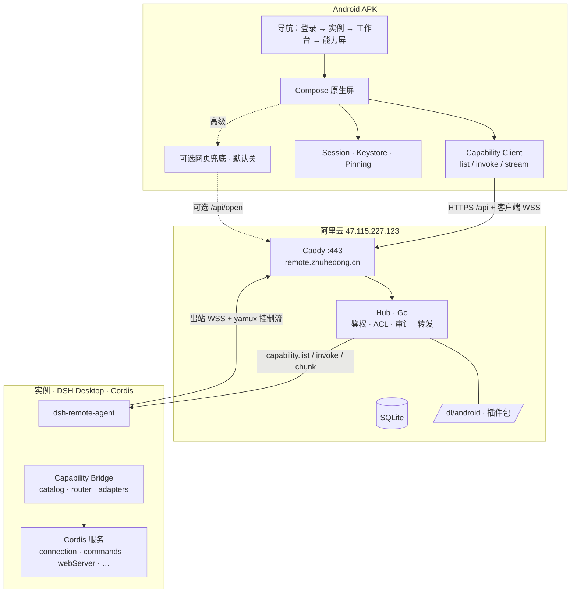
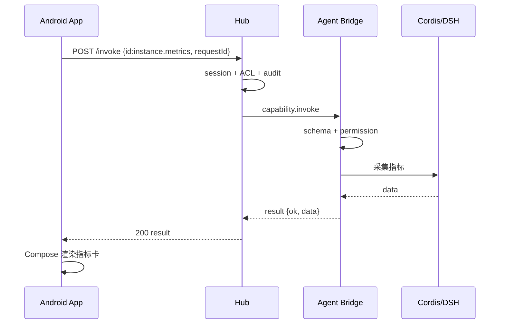

# DSH Remote · Android 客户端设计 v2（原生能力桥）

> 状态：设计稿，未改动任何代码或环境  
> 日期：2026-10-24（Asia/Shanghai）  
> 性质：**完整重做**，不在 v1 / v1.1 上小修。旧稿仅作历史参考。  
> 权威 Hub / 插件骨架：`/workspace/remote-mgmt-design-v3.1.md`（及 `remote-mgmt/docs/` 同名副本）。

本文定义：**手机端 Android APK 如何作为原生遥控器，经 Hub → `dsh-remote-agent` Capability Bridge，直接调用桌面 DSH 的功能**。安卓不是设备 Agent；设备端仍是装在 DSH Desktop 里的 TypeScript 插件。

---

## 0. 一句话产品定义

**DSH Remote Android = 装在手机上的原生「能力客户端」：登录 Hub 后选中一台已登记的 DSH Desktop，用 Compose 原生界面调用该机上的 DSH 能力（状态、日志、重启、以及探针确认后的对话/模型等），结果以结构化数据流式画在手机上——不是远程打开 dsh web。**

| | 能力桥（本设计默认） | 远程打开网页（v1 及以前） |
|---|---|---|
| 手机在干什么 | 原生 UI + RPC | 迷你浏览器 / WebView |
| 桌面在干什么 | 插件在 DSH 进程里执行能力 | 把整页 dsh web 代理出来 |
| 用户感知 | 「在手机上用桌面功能」 | 「在手机上开网页」 |
| 协议 | `capability.list` / `invoke` / chunk | `/api/open` + 子域 cookie + SSO |
| 插件改动 | **必须**新增 Bridge | 可零改动（仅代理） |
| 未覆盖功能 | 空状态 / 提示升级 / 可选网页兜底 | 网页里什么都有 |

**Pros（能力桥）**

- 真正调用桌面端功能，不是套一层网页。
- 结构化结果便于流式对话、离线友好展示、无障碍与深色主题。
- 能力白名单：手机拿不到「整页浏览器」那一层隐式权限面。
- 与 Material 3 / 系统通知 / 生物识别原生集成。

**Cons（相对继续套网页）**

- Hub 与插件要新增协议、适配器与审计。
- L1（对话等）依赖真机只读探针；**DSH 未必有稳定公开 chat API**，可能延期或砍掉。
- 未映射能力要么做适配，要么暂时没有（或走可选网页兜底）。

---

## 1. 目标 / 非目标

**目标**

- 手机登录一次（密码 + 强制 TOTP），看到所有已登记实例；点进某实例进入**原生工作台**。
- 工作台能力卡片全部来自 `capability.list` ∩ App 已知集；调用走 `invoke`（可流式）。
- L0 管理能力与 v3.1 §8 对齐，A0 即可交付可用遥控器。
- L1 业务能力（对话、模型…）仅在真机探针确认稳定入口后进入 A1。
- 安全基线对齐 v3.1：ACL、敏感操作 10 分钟重验证、脱敏、审计、证书锁定、侧载验签。
- Hub 仍轻量；插件 Bridge 在 DSH 进程内额外开销可控（目标与 v3.1 同量级，不拖垮事件循环）。

**非目标**

- 不把 DSH 或 Agent 移植到安卓；安卓**不是**设备端。
- 不做完整复刻 DSH 全部 UI / 插件市场整页（L2）。
- 不做远程桌面、任意 shell、通用文件管理、任意 TCP/UDP。
- MVP 不上架 Play；不做完整 Passkey（留接入点）。
- 不做多 Hub / 企业 MDM。
- **不以 WebView 打开 `*.d.` 子域为主路径**（可作可选兜底，默认关闭或折叠）。

术语：

| 术语 | 含义 |
|---|---|
| **实例** | 一台装了 `dsh-remote-agent` 的 DSH Desktop |
| **Hub** | Go + SQLite，`remote.zhuhedong.cn` → 47.115.227.123 |
| **客户端** | 本设计中的 Android APK；桌面浏览器上的 Hub Web **只做管理台** |
| **能力桥（Capability Bridge）** | 插件内模块：把本机 Cordis / DSH 服务封装为可列举、可调用、可流式的能力 |
| **能力（Capability）** | 带 `id`、参数 schema、权限、可选 `stream` 的远程可调用操作 |
| **工作台** | 某实例下按能力目录渲染的原生首页 |

---

## 2. 默认决策（全部可改）

| # | 决策 | 默认 | 可改方向 |
|---|---|---|---|
| **D1** | 产品主路径 | **能力桥**：Phone Compose → Hub → Agent Bridge → DSH Cordis | 退回网页主路径（不推荐） |
| D2 | 技术栈 | Kotlin + Jetpack Compose + Material 3；minSdk 28；OkHttp（HTTP + 可选 WS）；EncryptedSharedPreferences + Android Keystore | Flutter / RN（不推荐） |
| D3 | 网页路径 | **默认关闭**；设置里「高级 → 在网页中打开」可选；不作为 CTA | 完全删除 / 默认显示入口 |
| D4 | 认证 | 用户名 + 密码 + **强制 TOTP**；生物识别只解锁本地会话缓存 | 远期 Passkey |
| D5 | 流式通道 | App ↔ Hub：**客户端 WSS**（与 Hub 事件同源）；Hub ↔ Agent：既有控制流 | SSE / 长轮询 |
| D6 | 分发 | 侧载：`https://remote.zhuhedong.cn/dl/android/` + `latest.json`（versionCode、apkUrl、sha256） | 上架 Play / 国内商店 |
| D7 | 安全 | 主域公钥 pinning；禁明文；敏感能力重验证；invoke 审计；chunk 不写 logcat | pinning 例外列表 |
| D8 | 与 Web 控制台 | **Web 只做管理**（用户、ACL、登记、审计、插件包）；**手机主端 = 能力客户端**；PWA 不作为能力端 | 给 Web 也加能力工作台 |
| D9 | 能力版本 | App ∩ agent 取交集；UI 只显示双方都支持的；关键 L0 缺失 → 提示升级插件 | 强制最低 agent 版本 |
| D10 | L1 | **先真机只读探针**，再封装；文档与 UI **不假装**已有公开 chat API | A0 仅 L0，永久不做 L1 |
| D11 | 包名 / 显示名 | `cn.zhuhedong.remote` / 「DSH 远程」 | 用户另定 |
| D12 | 推送 | MVP：在线时靠 WSS 事件；离线暂不推；FCM 留给 Hub 0.2+ | 一开始就接 FCM |

---

## 3. 端到端架构



**默认调用路径（一次 invoke）**

1. App 已登录，持有会话；进入实例工作台。
2. `GET /api/instances/:id/capabilities`（或 WSS 等价）→ Hub 向在线 Agent 要目录（可短缓存）→ 与 App 本地已知 id 求交 → 渲染卡片。
3. 用户点能力 → `POST /api/instances/:id/invoke` 或 WSS `capability.invoke`，带 `requestId` + params。
4. Hub：鉴权会话 → 查 ACL（permission）→ 敏感则查重验证窗口 → 审计落库 → 经控制流下发到该实例。
5. Agent Bridge：schema 校验 → 调对应 adapter → 调本机 Cordis/DSH → 同步 `result` 或流式 `chunk`/`done`。
6. Hub 把事件推回该用户客户端通道；App Compose 渲染。

**明确不是默认路径**：Phone → `dsh--*.d.remote.zhuhedong.cn` → 整页 dsh web。

**不变（对齐 v3.1）**：登记码、出站 WSS、yamux、发布验签、本机 `authenticatedUrl` SSO（仍供 Web 管理台「打开 DSH」与可选兜底）、日志脱敏规则。

---

## 4. 能力模型

### 4.1 目录项（Capability Descriptor）

```json
{
  "id": "instance.metrics",
  "title": "实时指标",
  "description": "CPU / 内存 / 负载 / 磁盘",
  "params": { "type": "object", "properties": {}, "additionalProperties": false },
  "stream": false,
  "permission": "open",
  "sensitive": false,
  "minAgentVersion": "0.1.0",
  "minAppCapVersion": 1,
  "category": "observe"
}
```

字段约定：

| 字段 | 说明 |
|---|---|
| `id` | 稳定命名空间，如 `instance.*` / `plugin.*` / `chat.*` |
| `params` | JSON Schema（可简化子集）；Hub 与 Agent 双端校验 |
| `stream` | true 时走 chunk/done；false 时单次 result |
| `permission` | `open` \| `manage` \| `restart` \| `update`（对齐 v3.1 ACL） |
| `sensitive` | true → 需 10 分钟内重新验证（密码或 TOTP） |
| `category` | UI 分组：`observe` / `operate` / `chat` / `config` |

### 4.2 调用与流式

```text
capability.list
  → { agentCapVersion, capabilities: [Descriptor...] }

capability.invoke { id, params, requestId }
  → result { requestId, ok: true, data }
  | error  { requestId, ok: false, code, message }

# stream:true
event capability.chunk  { requestId, seq, data }
event capability.done   { requestId, ok, data? | error? }
msg   capability.cancel { requestId }   # 客户端取消
```

错误码建议：`UNAUTHORIZED` / `FORBIDDEN` / `REAUTH_REQUIRED` / `NOT_FOUND` / `OFFLINE` / `VALIDATION` / `INTERNAL` / `CANCELLED`。

### 4.3 版本协商

1. Agent 在 `welcome` 或 `capability.list` 带 `agentCapVersion` + 完整目录。
2. App 内置 `appCapVersion` + 已知能力 id → 渲染器映射表。
3. **UI 只展示交集**；未知 id 默认丢弃（调试开关可显示「原始 JSON」）。
4. 若 L0 关键能力（如 `instance.status`）缺失 → 工作台空状态：「请升级远程插件」，并链到 Hub 升级动作（若有 `update` 权限）。

### 4.4 ACL 与敏感操作

- Hub 按 `(user, instance, service|*, {open,manage,restart,update})` 过滤；能力声明的 `permission` 必须被允许。
- 插件端再校验一次（防 Hub 被攻破后任意下发）。
- `sensitive: true`：Hub 查会话「最近重验证」时间戳；过期返回 `REAUTH_REQUIRED`；App 弹重验证再重试同一 `requestId` 或新 id。
- 每次 invoke 审计：用户、实例、capability id、requestId、结果码；**参数脱敏**。

### 4.5 与既有管理 RPC 的关系

v3.1 已有状态 / 指标 / 日志 / 重启 / 升级等控制消息：**用薄 facade 映射为 L0 能力**，不维护两套语义。子域 HTTP 代理与 SSO **保留**给 Web 管理台，不删除。

---

## 5. 能力清单 L0 / L1 / L2

### 5.1 L0 — 对齐 v3.1 §8，A0 可做（不依赖未公开业务 API）

| 能力 id | 说明 | permission | stream | sensitive |
|---|---|---|---|---|
| `instance.status` | 在线、DSH/插件/OS/Node 版本、就绪态 | open | 否 | 否 |
| `instance.metrics` | CPU / 内存 / 负载 / 磁盘 / RSS / 事件循环延迟 | open | 否 | 否 |
| `instance.logs.tail` | 脱敏日志尾（环形缓冲 / 白名单文件） | manage | 可选 | 否 |
| `services.health` | 白名单本机服务健康 | open | 否 | 否 |
| `instance.enrollment` | 登记/连接摘要（指纹前缀、Hub、延迟） | open | 否 | 否 |
| `dsh.restart` | 重启 DSH（需本机 `remoteRestart`） | restart | 否 | **是** |
| `plugin.reload` | 重载本插件（若 Cordis 暴露） | restart | 否 | **是** |
| `plugin.update` | 自升级（走 v3.1 §9 验签） | update | 否 | **是** |

App 对应屏：工作台概览卡、指标卡、日志尾、操作区（确认对话框 + 重验证）。

### 5.2 L1 — 目标能力，**必须真机只读探针**后再做

| 目标 id | 期望体验 | 探针关注点 | 诚实说明 |
|---|---|---|---|
| `chat.sessions.list` | 会话列表 | 是否有稳定会话存储服务、ID、权限边界 | **DSH 未必提供稳定公开 chat API**；可能仅有 UI 内部状态 |
| `chat.message.send` | 发消息 + **流式回复** | 事件名、chunk 格式、取消/超时、与模型插件关系 | 同上；探针失败则 **不做进 A1** |
| `models.list` / `models.set` | 列表与切换 | 配置落盘、是否需重启、与「Our Free Model」等插件关系 | 可能只能改配置文件 + 提示重启 |
| `workspace.summary` | 工作区摘要 | 根路径、敏感路径脱敏 | 路径类数据需强脱敏 |

探针规则：

- **只读**：读源码 / 运行时 inject 的服务 / 既有 `connection.rpc` / 侧栏调用；禁止在探针阶段写生产数据。
- 输出一份「可否做 / 入口 / 风险」结论；失败则里程碑停在 L0 +（可选）网页兜底。
- **禁止**在设计或营销文案里写「已支持手机对话」直到探针通过并实现。

### 5.3 L2 — 明确不做

- 完整复刻 DSH 全部 UI、插件市场整页浏览与安装向导（超出 Bridge 范围的大市场）。
- 远程桌面、任意 shell、任意文件读写、通用 VPN/TCP。
- 把手机变成第二台 DSH / 在安卓跑 Agent。

---

## 6. Hub 新增 API / 控制流消息草图

### 6.1 面向 App 的 HTTP / WS

| 方法 | 路径 | 说明 |
|---|---|---|
| 既有 | `/api/auth/*`、`/api/me/sessions`、`/api/instances`… | 登录、会话、实例列表（v3.1 §13） |
| GET | `/api/instances/:id/capabilities` | 协商后的能力目录（可短缓存；实例离线返回上次快照 + `stale:true`） |
| POST | `/api/instances/:id/invoke` | body `{ id, params, requestId }`；短任务同步返回；长/流式返回 `accepted` |
| WS | `/api/me/events`（或 `/api/client/connect`） | 推送 `capability.chunk` / `done`、实例 online/offline、`REAUTH` 提示 |
| POST | `/api/me/reauth` | 敏感操作前重新验证 |
| GET | `/dl/android/latest.json` | `{ versionCode, versionName, apkUrl, sha256, minSdk }` |
| GET | `/dl/android/*.apk` | 侧载包 |

（名称实现时可对齐 OpenAPI；语义固定。）

### 6.2 Hub ↔ Agent 控制流（在流 0 JSON 上扩展）

```text
# 新增（与 hello/challenge/metrics 并列）
capability.list
capability.invoke { id, params, requestId, userId }
capability.cancel { requestId }

# 事件回传
event capability.chunk { requestId, seq, data }
event capability.done  { requestId, ok, ... }
```

Hub 职责：鉴权、ACL、重验证门禁、审计、按 `requestId` 把事件路由到发起该调用的客户端会话；**不解析业务 data 语义**（除脱敏与体积极限）。

### 6.3 限流与体积极限

- 每用户每实例 invoke QPS 上限（建议默认 5/s，突发 20）。
- 单次 result / 单 chunk 上限（建议 256KB；日志尾另设行数上限）。
- 流式最长时长（建议 10 分钟，可 cancel）。

---

## 7. 插件内 Bridge 模块目录

在 v3.1 §3.2 的 `dsh-remote-agent/` 上**增量**（不推翻 link/proxy/sso）：

```text
dsh-remote-agent/
├─ src/
│  ├─ …（既有 link / proxy / sso / control / keystore …）
│  └─ bridge/                    # 新增 Capability Bridge
│     ├─ index.ts                # 注册到控制流：list / invoke / cancel
│     ├─ catalog.ts              # 静态 + 动态组装 Descriptor[]
│     ├─ router.ts               # id → adapter；schema 校验；超时
│     ├─ types.ts                # Descriptor、InvokeRequest、Chunk…
│     ├─ redact.ts               # 能力结果脱敏（复用或扩展全局 redact）
│     ├─ adapters/
│     │  ├─ instance-status.ts   # L0
│     │  ├─ instance-metrics.ts
│     │  ├─ instance-logs.ts
│     │  ├─ services-health.ts
│     │  ├─ enrollment.ts
│     │  ├─ dsh-restart.ts
│     │  ├─ plugin-reload.ts
│     │  ├─ plugin-update.ts
│     │  └─ l1/                  # 探针通过后才添加
│     │     ├─ chat-sessions.ts
│     │     ├─ chat-send.ts
│     │     ├─ models.ts
│     │     └─ workspace.ts
│     └─ probe/                  # 仅开发/诊断：只读探测辅助（不进生产默认路径）
│        └─ README.md
```

约束：

- adapter **禁止**接收任意 URL / 任意 shell；只调白名单 Cordis 服务或既有 control 模块。
- 流式用异步迭代或事件转发，不在内存拼完整大对象。
- `ctx.on("dispose")` 时取消一切进行中的 invoke。

---

## 8. 安卓模块与导航信息架构

### 8.1 导航

```text
登录（用户名 / 密码 / TOTP）
  └─ 实例列表
        ├─ 实例工作台（能力卡片 · 按 category 分组）
        │     ├─ 原生 · 状态与指标（L0）
        │     ├─ 原生 · 日志尾（L0）
        │     ├─ 原生 · 操作：重启 / 升级（L0，重验证）
        │     ├─ 原生 · 对话（L1，探针成功后）
        │     ├─ 原生 · 模型（L1）
        │     └─ （高级）在网页中打开 —— 默认隐藏
        └─ 设置
              会话与踢出 · 生物识别锁 · Pinning 状态
              检查更新 · 关于 · 高级（网页兜底开关）
```

主 CTA：**进入工作台**，不是「打开 DSH 网页」。

### 8.2 建议模块结构

```text
dsh-remote-android/
├─ app/src/main/java/cn/zhuhedong/remote/
│  ├─ ui/
│  │  ├─ auth/          # Login
│  │  ├─ instances/     # 列表
│  │  ├─ workbench/     # 能力卡片网格
│  │  ├─ observe/       # status / metrics / logs
│  │  ├─ operate/       # restart / update + ReauthSheet
│  │  ├─ chat/          # L1 占位；探针前不进导航
│  │  ├─ settings/
│  │  └─ theme/
│  ├─ data/
│  │  ├─ api/           # Retrofit：auth、instances、capabilities、invoke
│  │  ├─ ws/            # 客户端事件通道
│  │  └─ db/            # 可选：能力目录短缓存
│  ├─ domain/           # UseCase：Login、ListCaps、Invoke、ObserveStream
│  ├─ security/         # Pinning、Keystore、Reauth
│  ├─ update/           # /dl/android/latest.json
│  └─ fallback/         # 可选 WebView；默认不编译进主路径导航
```

---

## 9. 安全与威胁

对齐 v3.1 §12，并针对能力桥增量：

| 威胁 | 对策 |
|---|---|
| 伪冒 Hub / MITM | HTTPS + 主域公钥 pinning；禁明文 |
| 能力越权 | Hub ACL + 插件 permission 再校验 + params schema |
| 把手机当任意 RCE | **无**任意 shell；能力白名单；禁止适配器收任意目标地址 |
| 敏感误触 | `sensitive` + 10 分钟重验证 + 确认对话框 |
| 会话窃取 | Keystore 存会话；远程踢出；锁屏生物识别仅解锁本地 |
| 流式内容泄露 | 结果脱敏；chunk 不写 logcat；可选 FLAG_SECURE（按屏） |
| 恶意 APK / 插件 | APK sha256（latest.json）；插件仍走离线发布公钥 |
| L1 探针误伤 | 只读探针；封装前代码评审；失败不发布适配器 |
| Hub 被攻破 | 插件仍只执行白名单能力；远程重启需本机开关；无通用命令通道 |
| 备份泄露会话 | `allowBackup=false` 或排除 EncryptedSharedPreferences |

---

## 10. 分发

- 首期：**侧载**。Hub 托管 `GET /dl/android/latest.json` 与 APK。
- App 启动或设置页「检查更新」：比对 `versionCode`，展示 changelog（可选字段），校验 sha256 后交给系统安装器（需用户确认）。
- 签名：同一 upload key 持续签名；文档写明指纹，便于用户核对。
- 不上架 Play 直至另开里程碑；国内商店同理。

---

## 11. 里程碑 A0–A2

| 阶段 | 内容 | 依赖 | 状态 |
|---|---|---|---|
| **A0** | 冻结 capability schema；Hub `capabilities`/`invoke`/事件通道；Agent Bridge + **全部 L0 facade**；App 登录→列表→工作台→L0 原生屏；侧载更新检查 | Hub/插件控制流可用 | 未完成 |
| **A1** | 真机 **只读** L1 探针报告；若通过：`chat.*` / `models.*` 等适配器 + 原生对话流式 UI | A0；用户提供探针窗口 | 未完成（门禁） |
| **A2** | 可选网页兜底（默认关）；设置项；空状态与升级引导打磨；安全复查清单 | A0 | 未完成 |
| 并行 | v3.1 Hub 0.1–0.3（登录、登记、WSS、管理 RPC） | — | 按 v3.1 |
| **1.0** | 能力集冻结、文档、威胁复查 | A0 +（可选 A1） | 未完成 |

硬门禁：**A1 不得在探针完成前合并「已支持对话」的代码路径或文案。**

---

## 12. 开放问题

1. **最想先在手机上原生用的桌面功能 Top3？**（对话 / 切模型 / 日志 / 重启 / 指标 / …）→ 决定 A0 卡片排序与是否提前排期探针。
2. 网页兜底：默认完全隐藏，还是「高级」里保留？
3. 流式：确认默认客户端 WSS，还是改 SSE？
4. 包名 `cn.zhuhedong.remote`、显示名「DSH 远程」是否 OK？
5. 是否长期 Hub 侧载，还是计划上架商店？
6. MVP 可否无 FCM？
7. 生物识别锁默认开还是关？
8. minSdk 28 是否覆盖你的主力机？
9. **L1 探针档期**：哪台已装 DSH Desktop 的机器、何时可做只读探测？
10. 能力命名：`instance.*` / `chat.*` 是否接受？
11. Web 控制台是否**永远**只做管理，还是以后也要能力工作台？

---

## 13. 对 v3.1 的影响

**不变**

- Hub 部署形态、Caddy、登记码语义、出站 WSS + yamux、发布验签、本机 SSO `authenticatedUrl`、脱敏与审计骨架、角色与实例 ACL 模型。
- 设备端仍是 `dsh-remote-agent` 插件；安卓不是 Agent。

**要新增（建议作为 v3.1 补丁或 v3.2 小节，本文为安卓权威）**

| 层 | 增量 |
|---|---|
| Hub | `/api/instances/:id/capabilities`、`…/invoke`、客户端事件 WSS、`/dl/android/*`、invoke 审计与限流 |
| 插件 | `src/bridge/**` Capability Bridge；L0 映射既有 control；welcome 带 `agentCapVersion` |
| 控制流 | `capability.list` / `invoke` / `cancel` + chunk/done 事件 |
| Web 控制台 | **仍以管理为主**（实例、用户、ACL、登记、审计、插件包）；「打开 DSH」保留给桌面浏览器；不强制做手机能力工作台 |
| 威胁模型 | 能力白名单防 RCE 语义；手机客户端 pinning / 会话 |

**明确废弃的产品叙事**

- 「手机端 = 打开 dsh web 的壳」——由本文 v2 取代。
- v1「插件零改动」——对能力客户端路径不再成立。

---

## 14. 测试计划（摘要）

- 协议：交集渲染、未知能力丢弃、无重验证敏感 invoke → `REAUTH_REQUIRED`。
- L0：离线实例、日志脱敏、重启确认、升级验签失败提示。
- 流式：乱序 seq、cancel、超时、断线重连后 requestId 作废。
- 安全：pin 失败、备份无会话、越权实例、schema 多余字段拒绝。
- 回归：默认路径自动化**不得**依赖 WebView；若启用兜底，单独用例。

---

## 15. 下一步（设计通过后）

1. 你拍板开放问题 **#1 Top3**，以及 #2/#9。  
2. 冻结 Descriptor / invoke JSON Schema 草案（可放 `remote-mgmt/docs/capability-schema-draft.json`）。  
3. Agent 实现 Bridge + L0；Hub 转发；App 空工程打通一条 `instance.status`。  
4. 另开「L1 探针」任务：只读结论后再开 A1。

---

## 附录 A · 与旧稿关系

| 文档 | 状态 |
|---|---|
| `android-client-design-v1.md` | 已废弃（网页主路径） |
| `android-client-design-v1.1.md` | 已废弃（过渡纠偏；被本文完整重做取代） |
| **本文 v2** | **当前权威安卓设计** |
| `remote-mgmt-design-v3.1.md` | Hub / 插件权威；本文扩展客户端与 Bridge |

## 附录 B · 一次成功的 L0 调用时序


