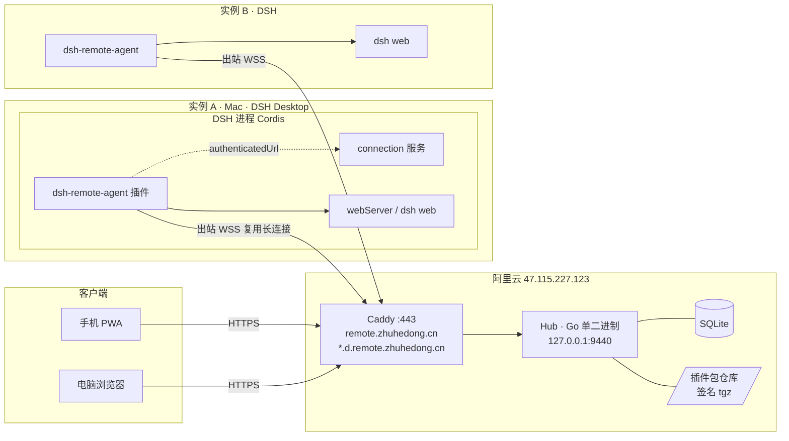
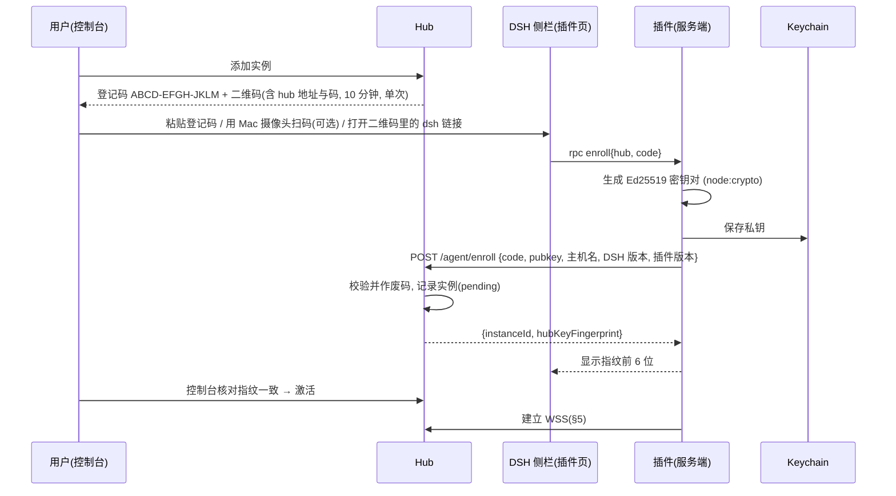
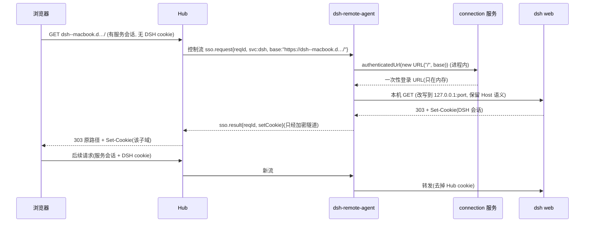
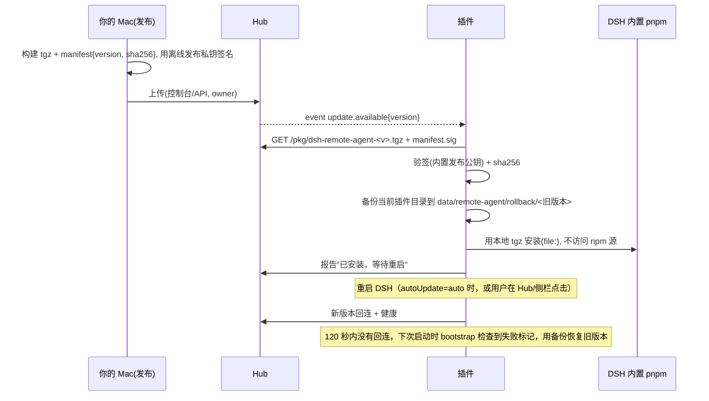

# DSH 远程管理平台设计 v3.1（Hub + DSH 插件）

> 状态：设计稿，未改动任何代码或环境
> 日期：2026-10-21
> 相对 v3 的变化：设备端确定为**装在 DSH 里的插件**（TypeScript，Cordis 插件），不再是 Go 独立程序。

---

## 0. 需求（已确认）

> 在阿里云 47.115.227.123 上自建一个 **Hub（服务端）**，经现有 Caddy 以 `remote.zhuhedong.cn` 对外。每台跑 **DSH Desktop** 的机器装一个 DSH 插件 **`dsh-remote-agent`**，主动连到 Hub。用户在手机或浏览器上登录 Hub 一次，就能看到所有 DSH 实例的在线状态，点开任意一台的 DSH（自动免二次登录），并做以 DSH 为中心的管理：状态、指标、日志、重启 DSH 或插件、升级插件。

管理范围以 DSH 为中心：
- 代理本机 **DSH web**，也可选代理白名单里的其它本机网页服务。
- 不做通用设备管理（远程桌面、任意命令）。
- 远程终端只作为远期可选项。

术语：
- **实例**（Instance）：一台装了插件的 DSH。
- **客户端**（Client）：用来访问的手机或浏览器。

---

## 1. 目标 / 非目标

**目标**
- 一个 Hub 管多台 DSH。设备只需要能向外访问 443，所以在 NAT、Clash、公司网络后面也能用。
- 只登录一次（密码 + 强制 TOTP，可选 Passkey），多个客户端可以同时在线，会话可以单独踢出。
- 打开 DSH 时通过 DSH 自己的 `connection.authenticatedUrl` 免二次登录。这一步在实例本机完成，令牌不离开那台机器。
- 插件安装、升级都走 DSH 自带的插件机制（内置 pnpm），升级包由 Hub 签名分发，不依赖 GitHub 和 npm 源。
- Hub 要轻：在 1.7GB 内存的服务器上常驻 < 80MB；插件在 DSH 进程里额外占用 < 30MB。

**非目标**
- MVP 不做独立守护进程。没装 DSH 的机器以后再考虑（§16）。
- 远程桌面、通用 VPN、任意 TCP/UDP 转发。
- 多 Hub 高可用；超过 50 个实例、10 个用户的规模。
- 远程终端、文件传输：放到远期，默认关闭。

---

## 2. 架构



请求路径：客户端 → Caddy（TLS）→ Hub（鉴权、权限检查）→ 在该实例的复用连接上开一条流 → 插件 → 本机 dsh web 或白名单服务。

| 组件 | 职责 |
|---|---|
| **Hub** | 用户、会话、权限；实例登记与身份验证；接收插件连接；反向代理；指标、审计、通知；托管签名插件包；内嵌 Web 控制台 |
| **dsh-remote-agent（DSH 插件）** | 连 Hub 并保持复用连接；把流转发到本机 dsh web 或白名单服务；在本机执行 SSO；上报状态、指标、日志；执行管理命令（重启 DSH 或插件、升级自身）；管理 trustedHosts；在 DSH 侧栏提供登记和状态页面 |
| **Web 控制台** | 实例列表、打开 DSH、管理、用户与权限、会话、审计；手机优先的 PWA |

v1/v2 里的 frp、Cloudflare、Tailscale 只保留为**备选接入路径**，用在实例连不上阿里云时，属于远期。默认插件直接用 WSS 连 Hub。

---

## 3. 插件设计（基于现有 dsh-cloudflare-tunnel 的接入方式）

### 3.1 参照：现有插件怎么接入 DSH（0.8.0，已读 Mac 上安装的版本）

| 方面 | 现有做法 | 新插件沿用 |
|---|---|---|
| 包结构 | ESM，`main: index.js`，`exports: { ".", "./client" }`，`package.json.dsh.bundle.patch: ./cordis.patch.yml`，`dsh.client.inject: [dsh-client-connection, dsh-client-ui-sidebar, dsh-client-ui-slots]`，`platform: web` | 相同 |
| 入口 | `export const name`、`export function apply(ctx, config)`、`apply.inject = []`；服务都通过 `ctx.inject([...], cb)` 懒加载（读没声明的服务会抛错） | 相同；注入 `webServer`、`connection`、`commands`，可选注入 `dshIm` |
| 配置 | `export const Config`，用 `@deepseek-ai/schemastery`（peer、optional），加载失败时用默认值 | 相同 |
| 配置持久化 | 写回 `harness/profiles/web/cordis.patch.yml` 中本插件条目 | 相同（不含密钥） |
| 控制接口 | `webServer.register({kind:"prefix", path, handler})`，先过 `connection.requestRejection(req)` 做本机鉴权，使用 `client-request`/`server-response` 消息格式；`connection.rpc.handle` 作后备 | 相同，前缀 `/dsh-remote-agent` |
| UI | `client.js` 用 `window.__ModuleLoader__.load({id, factory})` 注册 React 组件，放在侧栏 `sidebar.footer.action` 插槽，通过 `ctx.connection.rpc.call(prefix, ep, payload)` 调用服务端 | 相同，入口叫"远程管理" |
| SSO | `connection.authenticatedUrl(new URL("/", base))` → 服务端 GET → 拿 303 的 Set-Cookie | 相同，但 cookie 通过隧道交给 Hub（§6） |
| 本机地址 | 在 `webServer` 的 effect 里读 `ws.host/ws.port`，端口变了会重新触发 | 相同 |
| 生命周期 | `ctx.on("dispose", cleanup)` + `process.once("exit")` | 相同；dispose 时向 Hub 发 `goodbye` |
| trustedHosts | `cordis.patch.yml` 中 `@deepseek-ai/dsh-client-connection` 的 `trustedHosts: !!js "[..., ...ctx.webStartup.trustedHosts]"` | 插件自动维护（§6.4） |
| 命令 | `commands` 服务注册 `/tunnel status/start/stop` | 注册 `/remote status/enroll/disconnect` |

### 3.2 目录结构
```
dsh-remote-agent/
├─ package.json            # dsh.bundle.patch、dsh.client.inject（同上）
├─ cordis.patch.yml        # 默认配置条目
├─ index.js                # 编译产物入口（源码为 TS）
├─ client.js               # 侧栏 UI（React，经 __ModuleLoader__）
├─ src/
│  ├─ index.ts             # apply(ctx, config)：装配、inject
│  ├─ schema.ts            # Config（schemastery）
│  ├─ link/
│  │  ├─ socket.ts         # WSS 连接（ws 库）
│  │  ├─ mux.ts            # 多路复用（见 §5.3）
│  │  ├─ handshake.ts      # 挑战签名
│  │  └─ reconnect.ts      # 退避、睡眠唤醒检测
│  ├─ proxy/
│  │  ├─ stream-http.ts    # 流 ↔ 本机 http 请求（含 WS 升级）
│  │  └─ services.ts       # 白名单服务表
│  ├─ sso.ts               # authenticatedUrl 交换
│  ├─ control/
│  │  ├─ rpc.ts            # Hub 下发命令分发
│  │  ├─ metrics.ts        # os.loadavg/cpus/freemem、磁盘(statfs)、DSH 状态
│  │  ├─ logs.ts           # 白名单日志末尾 N 行（脱敏）
│  │  ├─ restart.ts        # 重启 DSH / 插件
│  │  └─ update.ts         # 自升级
│  ├─ keystore/
│  │  ├─ index.ts
│  │  ├─ keychain-macos.ts # security CLI
│  │  └─ file.ts           # 加密文件后备
│  ├─ hosts.ts             # cordis.patch.yml trustedHosts
│  ├─ redact.ts  audit.ts  logger.ts
│  └─ local-api.ts         # 侧栏 UI 的控制接口
├─ vendor/                 # 打包进来的依赖（ws、qrcode），避免安装时联网
└─ test/
```
构建：用 esbuild 把 TS 和依赖打包成单个 `index.js`（ESM，target node22），不需要额外 `node_modules`。这样内置 pnpm 安装时不用联网拉依赖，国内、离线都能装。

### 3.3 配置（schemastery，示例）
```yaml
- id: remote-agent
  name: dsh-remote-agent
  config:
    hub: https://remote.zhuhedong.cn
    instanceName: MacBook-Pro            # 默认取主机名
    autoConnect: true
    services:                            # 额外暴露的本机服务（DSH 自身总是包含）
      - id: grafana
        name: Grafana
        target: http://127.0.0.1:3000
    allowLan: false                      # 是否允许非 127.0.0.1 目标
    remoteRestart: true                  # 是否允许 Hub 远程重启 DSH/插件
    autoUpdate: notify                   # off | notify | auto
    logFiles: []                         # 允许远程查看的日志
    proxy: system                        # system | direct | http://127.0.0.1:7890
    manageTrustedHosts: true
```
不放进配置的东西：设备私钥（Keychain）、Hub 公钥指纹（`data/remote-agent/state.json`）、实例 ID。

---

## 4. 实例登记


- 登记码：60 bit 随机数，Hub 只存哈希；10 分钟内有效、只能用一次，错 5 次作废。
- 二维码内容为 `https://remote.zhuhedong.cn/enroll#<code>`（码放在 `#` 后面，不会发给服务器日志），手机扫了也只是展示码。
- 吊销：控制台删除实例 → Hub 删公钥并断开连接；插件收到 `revoked` 后清掉本地私钥和状态。
- 重装 DSH 或换机：重新登记，可选"替换已有实例"以保留名称和权限。

## 5. 连接（Node 实现）

### 5.1 分层
```
TLS 1.3 (Caddy) → WebSocket /agent/connect → 多路复用帧
  流 0：控制（JSON：hello / challenge / auth / ping / metrics / rpc / event）
  流 N：每个被代理请求一条（HTTP/1.1 原始字节，含 WebSocket 升级）
```

### 5.2 握手
`hello{instanceId, versions}` → Hub `challenge{nonce, ts}` → 插件 `auth{Ed25519(nonce‖ts‖instanceId‖"dra-v1")}` → `welcome{services 版本, 设置}`。同一个实例只允许一条连接，新连接认证通过后踢掉旧的。

### 5.3 多路复用库选择
| 方案 | 评价 |
|---|---|
| **自写精简 yamux 兼容帧（推荐）** | yamux 协议简单（12 字节头，含 data/window/ping/goaway），Node 实现约 500 行。Hub 用 Go 的 `hashicorp/yamux` 直接对接，两端互通性有成熟参照；无第三方依赖，便于打包和审计 |
| `yamux-js` / `@chainsafe/libp2p-yamux` | 前者维护少；后者依赖整个 libp2p 生态，体积大、依赖多 |
| HTTP/2 over WebSocket | Node `http2` 不支持在任意 duplex 上做服务端会话的反向用法，Hub 侧也要反转角色，复杂 |
| 每个请求一条 WebSocket | 简单，但每次都要 TLS + 认证，手机打开 DSH 时几十个并发请求延迟高 |

WebSocket 客户端用 **`ws`**（Node 生态事实标准，支持 `agent` 走 Clash HTTP 代理 + `https-proxy-agent`），打包进 vendor。Node 22 自带的全局 `WebSocket` 不能设代理和自定义 TLS 选项，所以不用它。

### 5.4 心跳、重连、背压
- 每 20s ping，45s 没回应视为断线。
- 断线后按 1s→60s 指数退避重连（加抖动）。检测到 macOS 睡眠唤醒（计时器跳变 > 30s）时立即重连。
- 每条流有 256KB 窗口，靠 `stream.write()` 返回值和 `drain` 事件做背压；本机 http 响应用 `pipe`。
- 每个实例最多 256 条并发流；单个请求体默认上限 100MB；空闲 120s 超时。
- 插件只连本机白名单服务：Hub 只能说"打开服务 `dsh`"，不能传地址。

### 5.5 对 DSH 进程的影响
插件和 DSH 在同一个 Node 进程里，所以：
- 所有代理 I/O 都是流式，不缓存整个请求体。
- 指标采集每 30s 一次，耗时 < 5ms。
- 出错时只断开那一条流，插件内部异常统一 catch，不能拖垮 DSH。
- 自测：50 条并发流下 DSH 事件循环延迟增加 < 10ms。

---

## 6. 访问路由与 SSO

### 6.1 路由
- 默认用子域名：`https://<svc>--<inst>.d.remote.zhuhedong.cn/`，如 `dsh--macbook.d.remote.zhuhedong.cn`。每个服务一个独立源，DSH 用的绝对路径和 WebSocket 都不用改写。
- 路径方式（`/i/<inst>/<svc>/`）不采用，原因是绝对路径、cookie 和 WS 都会出问题。
- 证书二选一（开放问题）：
  - A：给 Caddy 加阿里云 DNS 插件，签泛域名证书。需要一个只有 DNS 权限的 AccessKey。
  - B：Caddy 按需签发（on-demand TLS），Hub 提供 `ask` 接口，只放行已存在的名字。
- zhuhedong.cn 已备案，子域名沿用主域备案。

### 6.2 跨子域登录
1. 控制台点"打开 DSH"，Hub 发一张一次性票据：30 秒有效、只能用一次，绑定用户、实例和服务。
2. 浏览器 303 到 `dsh--macbook.d…/__hub/enter?t=…`，Hub 兑换票据后在该子域设置服务会话 cookie（`__Host-`、HttpOnly、SameSite=Lax）。
3. 再 303 到不带票据的地址，并设置 `Referrer-Policy: no-referrer`。
4. 服务会话从属于主会话：主会话被踢，服务会话立即失效。主控制台的 cookie 不下放到父域，所以不会泄露给 zhi-stack 等其它站点。

### 6.3 DSH 免二次登录（插件在本机执行）

- 令牌只存在于实例进程内存里。DSH cookie 由 Hub 透传，Hub 不保存、不写日志。
- 什么时候触发 SSO：请求里没有 DSH cookie，或者 dsh web 回了 401 / 跳到登录页。每个服务会话每 10 分钟最多触发一次，防止循环。
- 实例上关掉 SSO 时，退回到让用户自己登录 DSH。

### 6.4 trustedHosts 自动管理
- 登记成功或实例改名后，插件把 `dsh--<inst>.d.remote.zhuhedong.cn` 写进本机 `cordis.patch.yml` 中 `@deepseek-ai/dsh-client-connection` 的 `trustedHosts`。插件只管自己加的条目（用标记注释区分），保留 `...ctx.webStartup.trustedHosts`。
- 已有的 `dsh.cli-help.com` 默认由插件接管管理。
- 写之前备份，写完后用 YAML 解析校验，失败就回滚。
- 改动需要重启 DSH 才生效：侧栏和 Hub 控制台都会提示，用户点"一键重启"。不会自动重启。

### 6.5 WebSocket
DSH 的 `/api` WebSocket 原样双向转发。Host 白名单的问题由 §6.4 解决，这正是 v1 里 403 的根本原因。

---

## 7. 用户、权限、会话
- 登录：用户名 + 密码（argon2id）+ **强制 TOTP**，可选 Passkey。首个 owner 用 Hub 首次启动时生成的一次性 setup token 创建。
- 角色：owner / admin / member。实例级权限 `(user, instance, service|*, {open, manage, restart, update})`。
- 会话：每个客户端一条，记录 UA、IP、最后活动时间。空闲 7 天、最长 30 天过期。可以踢出单个或全部；做敏感操作（吊销实例、改权限、远程重启、升级）前要在 10 分钟内重新验证一次。
- 限速：按 IP 和用户，失败 5 次锁 15 分钟；异常登录会通知。

---

## 8. 以 DSH 为中心的管理功能

| 功能 | 插件端实现 | 权限 |
|---|---|---|
| 在线状态、版本 | 控制流 hello、心跳；DSH 版本、插件版本、OS、Node 版本 | open |
| 指标 | `os` 模块：CPU（两次采样差值）、内存、负载；`fs.statfs`：磁盘；进程 RSS、事件循环延迟；30s 一次 | open |
| DSH 状态 | webServer 是否就绪、已装插件列表和版本（读 `profiles/web/package.json`）、错误计数 | open |
| 日志 | DSH 日志（ctx.logger 的环形缓冲，最近 500 条）和配置里列出的白名单日志文件末尾；都先脱敏 | manage |
| 重启 DSH | 先找 DSH 官方提供的重启能力（命令或服务），没有就用 `app.relaunch`；需要本机 `remoteRestart: true` | restart |
| 重载某个插件 | 通过 Cordis 的 scope 重新加载（如果 DSH 暴露了这个能力），否则只能整体重启 | restart |
| 插件自升级 | §9 | update |
| 白名单服务健康 | 定期 HEAD | open |
| 离线通知 | Hub 端：断线超过 2 分钟才通知（dsh-im、邮件或 Webhook） | — |

插件在本机侧栏会显示"最近的远程操作"，比如"18:20 hub 用户 me 重启了 DSH"，让本机用户知道发生了什么。

---

## 9. 插件升级（走 DSH 插件机制）


- 发布密钥和 Hub 无关：Hub 被攻破也签不出恶意插件。
- 回滚需要一段始终可用的启动检查：新版本启动时写"已启动"标记；DSH 下次启动发现上次的新版本没写这个标记，就恢复备份。具体放在插件 `index.js` 最前面一个很小的 bootstrap 里。
- 首次安装：Hub 的 `/dl/dsh-remote-agent-<v>.tgz` 可以直接下载，在 DSH 里用内置 pnpm 安装本地文件。安装脚本会修正旧 `cft-up.sh` 的问题：参数分清路径和文件名，失败时回滚。

---

## 10. 密钥存储（Node）
- macOS：用 `security` 命令行（`add-generic-password -U -s dsh-remote-agent -a device-key -w`）。密钥值通过 **stdin** 传给它（`-w` 不带值时会从 stdin 读），这样不会出现在 `ps` 能看到的参数里；读取用 `find-generic-password -w`。不用原生模块（如 keytar），省得 DSH 的 Node 版本和 ABI 不匹配。
- 首次访问时 macOS 可能弹出"允许访问钥匙串"，需要用户点"始终允许"，UI 上会提示。
- 后备方案：AES-256-GCM 加密文件 `data/remote-agent/key.enc`（0600），密钥用 scrypt 从机器 ID（`ioreg` 的 IOPlatformUUID）加随机盐派生。只防随手复制，不防本机 root，文档里会写明。
- Hub 端：用户密码存 argon2id 哈希；TOTP 密钥用 Hub 主密钥（文件 0600 或环境变量）加密后存 SQLite。

---

## 11. 日志脱敏与审计
- 插件和 Hub 用同一套脱敏规则：已知密钥精确替换；正则兜底覆盖 Cookie、Set-Cookie、Authorization、URL 查询串里的 token/ticket、JWT、DSH 登录链接。
- Hub 访问日志：只记时间、用户、实例、服务、方法、去掉查询串的路径、状态码和字节数。
- 审计事件：登录、踢出、登记/吊销、打开服务、重启、升级、改权限、改设置。在 Hub 上保留 180 天，可导出；实例本机也记一份"远程操作"摘要。

---

## 12. 威胁模型

| 威胁 | 对策 |
|---|---|
| 暴力破解、撞库 | argon2id、限速锁定、强制 TOTP、Passkey、异常登录通知 |
| Hub 被攻破后控制所有 DSH | 插件只代理白名单服务；远程重启需本机允许；没有任意命令和终端；升级包必须有离线发布签名；SSO 令牌不经过 Hub |
| 伪造实例接入 | 一次性登记码 + 人工核对指纹 + 每次连接挑战签名 |
| 实例被盗或丢失 | 控制台吊销公钥；私钥在钥匙串 |
| 恶意插件包 | 签名清单 + sha256，本地 tgz 安装，失败回滚 |
| 插件拖垮 DSH | 流式处理、限流、异常隔离、事件循环延迟监控 |
| 会话劫持、CSRF | `__Host-` cookie、HttpOnly、SameSite、Origin 校验、CSRF token、敏感操作重新验证 |
| 服务之间 XSS 串扰 | 每个服务独立子域；控制台 cookie 不下放父域 |
| 票据泄露 | 30 秒、只能用一次、绑定用户、no-referrer |
| 日志泄露 | 统一脱敏 |
| Hub 资源耗尽 | 按实例、按用户限制并发和带宽，请求体上限 |
| 子域接管 | ask 接口只放行存在的名字；泛解析只指向自己的服务器 |
| 本机其他程序调用插件控制接口 | 走 `connection.requestRejection`，沿用 DSH 本机鉴权 |

---

## 13. Hub

- 技术栈：**Go**（单二进制，`net/http` + `httputil.ReverseProxy` + `hashicorp/yamux`）+ **SQLite**（`modernc.org/sqlite`，纯 Go），常驻 40–80MB。控制台用 Vite + Preact，构建后内嵌进二进制。
- 备选 Rust（`tokio` + `yamux` crate + `rusqlite`）：内存更低，也和 zhi-stack 统一，但开发周期长一些。协议是两端约定好的 yamux 帧，换语言不影响插件。
- 不选 Node 的原因：在已经跑着 zhi-stack 的 1.7GB 服务器上，Node 常驻 100MB 以上，不划算。
- 接口：`/api/auth/*`、`/api/me/sessions`、`/api/instances[/:id]`、`…/services`、`…/actions/{restart-dsh,reload-plugin,update}`、`…/metrics`、`…/logs`、`/api/enroll-codes`、`/api/open`、`/api/users`、`/api/acl`、`/api/audit`、`/api/notify`、`/api/releases`、`/agent/enroll`、`/agent/connect`、`/pkg/*`、`/dl/*`、子域 `/__hub/enter`。
- 数据表：users、passkeys、totp、sessions、service_sessions、instances、instance_keys、services、acl、enroll_codes、metrics（7 天）、audit、releases、settings。

### 部署（阿里云）
- 用二进制 + systemd（`/opt/remote-hub`，非 root 用户 `remotehub`），只监听 `127.0.0.1:9440`。复用 443，不用在安全组开新端口。
- DNS：`remote.zhuhedong.cn` 和 `*.d.remote.zhuhedong.cn` 都指向 47.115.227.123。
- Caddy 只追加站点，不动 zhi-stack；先 `validate` 再 `reload`，失败回滚：
  ```
  remote.zhuhedong.cn { reverse_proxy 127.0.0.1:9440 { flush_interval -1 } }
  *.d.remote.zhuhedong.cn {
    tls { dns alidns { access_key_id {env.ALIDNS_ID} access_key_secret {env.ALIDNS_SECRET} } }
    reverse_proxy 127.0.0.1:9440 { flush_interval -1 }
  }
  ```
  选 B 方案时改为全局 `on_demand_tls { ask http://127.0.0.1:9440/internal/tls-ask }`。
- 每天备份 SQLite（age 加密），保留 14 天。
- Hub 二进制和插件包都在 Mac 上构建、签名后 scp 上传，服务器不需要连 GitHub。

---

## 14. UI

**Hub 控制台（手机优先）**
```
┌ DSH 远程管理 ─────────────────── [我] ┐
│ ● MacBook-Pro   DSH 1.x  插件 0.1.0     │
│   CPU 12% 内存 61% 磁盘 48%             │
│   [打开 DSH] [Grafana] [管理 ▸]        │
│ ● office-mac    在线 3 天               │
│   [打开 DSH] [管理 ▸]                  │
│ ○ home-mac      离线 2 小时             │
│ [+ 添加实例]                           │
└────────────────────────────────────────┘
```
实例详情页分几个标签：
- 概览：状态、版本、指标图。
- 服务。
- 操作：重启 DSH、重载插件、升级。
- 日志。
- 权限。
- 审计。

**DSH 侧栏「远程管理」页（插件 client.js）**
```
远程管理
状态：● 已连接 remote.zhuhedong.cn（延迟 38ms）
实例名：MacBook-Pro   指纹：3fa9c1…
访问地址：https://dsh--macbook.d.remote.zhuhedong.cn
[断开]  [重新登记]

未登记时：
Hub 地址 [https://remote.zhuhedong.cn]
登记码   [____-____-____]  [登记]

本机服务：DSH ✔  Grafana ✔  [+ 添加]
允许远程重启 [✔]   自动升级 [仅提示 ▾]   免二次登录 [✔]
⚠ 白名单已更新，需要重启 DSH 生效  [立即重启]
最近远程操作：18:20 me 打开 DSH（iPhone）…
```

---

## 15. 从 dsh-cloudflare-tunnel 迁移
1. 部署 Hub，不影响现有的 `dsh.cli-help.com` 隧道。
2. 在你的 Mac 上安装 `dsh-remote-agent` 并登记，旧插件继续运行，两条路并存。新插件的白名单管理会接管 `dsh.cli-help.com`，保证旧隧道不受影响。
3. 用手机通过 Hub 打开 DSH，验证 SSO、WebSocket、没有 403。
4. 观察几天后关掉旧插件的 `autoStart`。最终先备份旧插件目录和配置，再用 DSH 内置 pnpm 卸载旧插件。trustedHosts 里的 `dsh.cli-help.com` 按你的选择保留或移除。
5. 回滚：重新启用旧插件，在新插件里断开连接即可，两者互不依赖。
- Hub 账号默认重新设置，不导入旧插件的密码和 TOTP，因为旧的哈希格式是 scrypt，新的是 argon2id。也可以导入后在首次登录时升级哈希，见开放问题。

---

## 16. 测试计划
- **插件单元测试**：schema、mux 帧编解码（和 Go yamux 用同一组测试向量）、握手签名、背压、重连（含模拟睡眠唤醒）、SSO（用假的 connection 服务）、trustedHosts 编辑和回滚、Keychain 适配器（用假的 `security` 命令）、脱敏、升级验签和回滚标记。
- **互通测试**：box 上真实 Go Hub 加多个 Node 插件进程（用模拟的 Cordis ctx），跑 50 个实例 × 20 条并发流，测 Hub 内存（目标峰值 < 120MB）和插件对事件循环的影响。
- **端到端**：box 上 docker 起 Caddy（自签证书）+ Hub；你的 Mac DSH 真机（需批准），测打开 DSH、SSO、WebSocket、上传、Clash 开和关、睡眠唤醒、DSH 重启后自动回连。
- **安全**：越权访问别人的实例、Hub 指定非白名单目标、票据重放、跨子域 cookie、CSRF、未签名或篡改的插件包、远程重启开关。
- **部署演练**：Caddy 配置回滚；SQLite 备份恢复；插件升级失败后回滚。

---

## 17. 里程碑

| 版本 | 内容 |
|---|---|
| **0.1.0 MVP** | Hub：登录 + TOTP、会话、实例登记、WSS + yamux、子域代理、跳转票据、SQLite、最小控制台。插件：登记页、连接、代理 DSH web、本机 SSO、trustedHosts 管理、Keychain。阿里云部署 |
| **0.2.0** | 指标和图表、DSH 状态、离线通知、审计页、白名单本机服务、会话管理（踢人） |
| **0.3.0** | 多用户、角色、实例级权限、重新验证、远程重启 DSH 和插件、日志查看 |
| **0.4.0** | 签名插件包自升级和回滚、Passkey、PWA |
| **0.5.0** | 备选接入路径（frp/Cloudflare 作为插件到 Hub 的后备）、Hub 自身升级工具 |
| 远期 | 独立守护进程，用于没装 DSH 的机器；远程终端（默认关）；文件传输 |
| **1.0.0** | 安全复查、文档、稳定版 |

---

## 18. 开放问题
1. 域名用 `remote.zhuhedong.cn` 和 `*.d.remote.zhuhedong.cn` 可以吗？
2. 证书选 A（泛域名，需要一个只有 DNS 权限的阿里云 AccessKey）还是 B（按需签发，首次打开慢几秒）？
3. 服务器公网带宽多少？决定默认限速。
4. Hub 用 Go（默认）还是 Rust（和 zhi-stack 统一）？
5. 第一批有哪几台 DSH？除了 DSH 还要暴露哪些本机服务？
6. Hub 账号重新设置（默认），还是导入旧插件的账号？
7. 远程重启 DSH 默认开还是关？自动升级默认"仅提示"可以吗？
8. 部署用二进制 + systemd（默认）还是 Docker？
9. 迁移后 `dsh.cli-help.com` 这条 Cloudflare 隧道保留作备用还是停用？
10. DSH 有没有官方的"重启自身 / 重载插件"接口？需要在你的 DSH 版本上确认（只读检查），确定 §8 用哪种实现。
